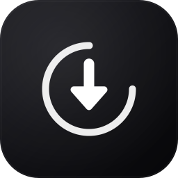
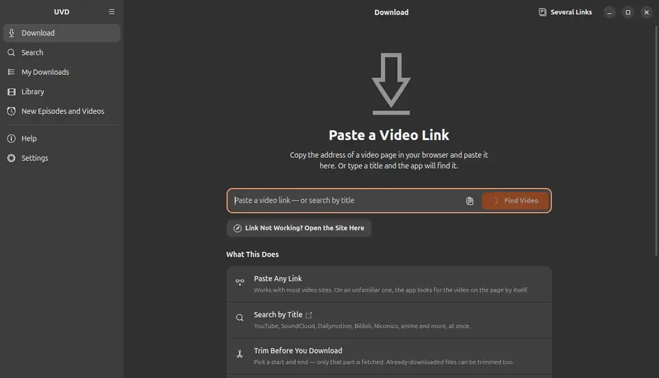
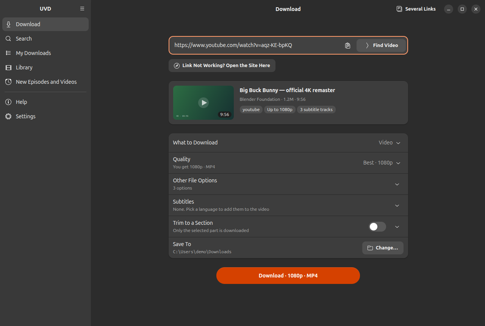
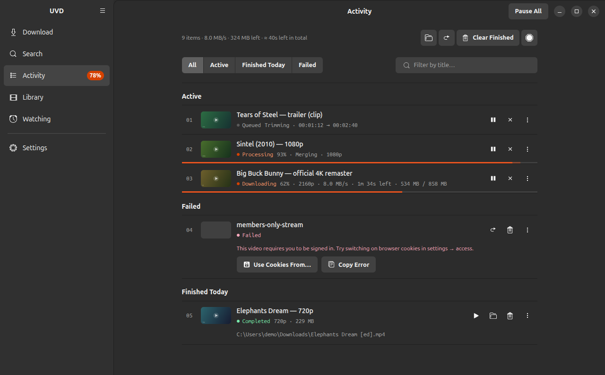
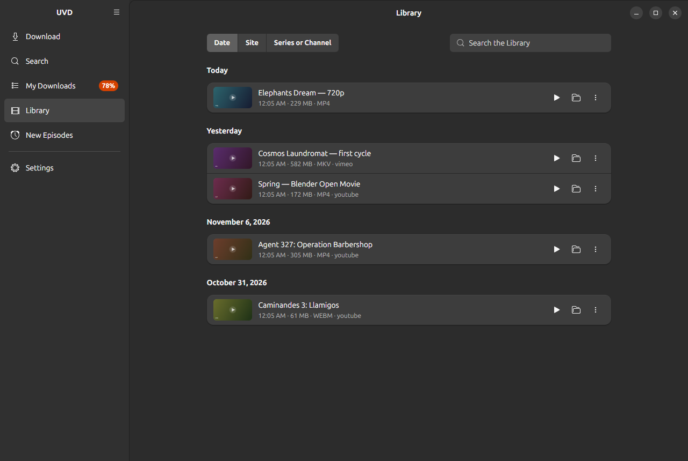
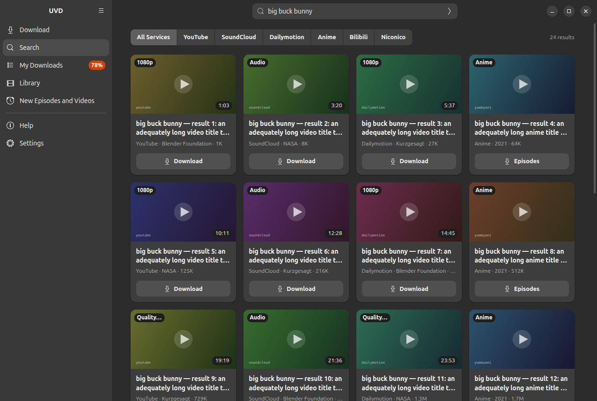
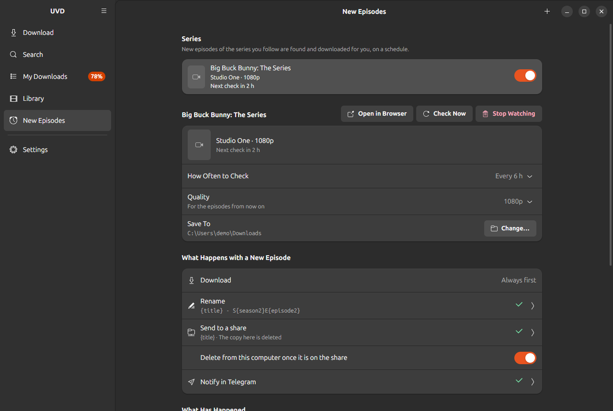
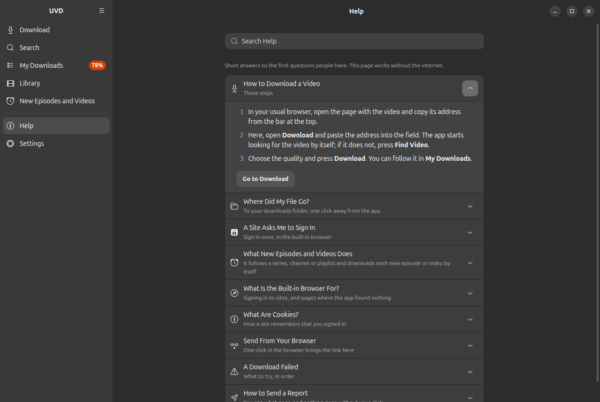
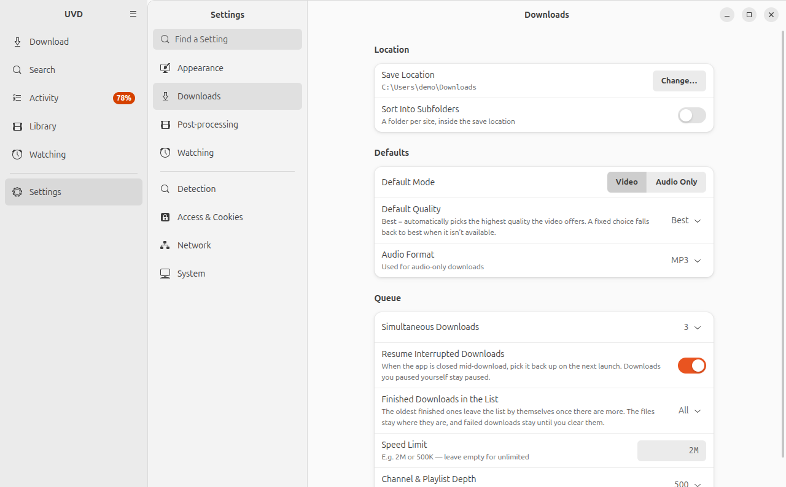
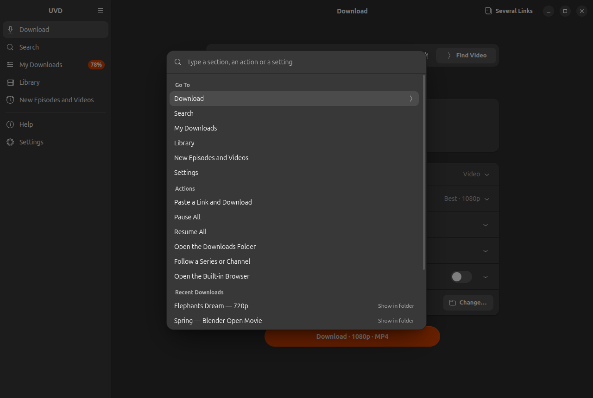

<div align="center">



# Universal Video Downloader

**Paste a link, get the video.**<br />
A free desktop app for Windows, macOS and Linux that downloads video from YouTube and 1800+ other sites,<br />
and finds the stream itself on pages nobody wrote an extractor for.

[](https://github.com/DenisHumen/Universal-Video-Downloader-/releases/latest)
[](https://github.com/DenisHumen/Universal-Video-Downloader-/releases/latest)
[](#linux)

[](https://github.com/DenisHumen/Universal-Video-Downloader-/releases/latest)
[](https://github.com/DenisHumen/Universal-Video-Downloader-/releases)
[](LICENSE)

**English** · [Русский](README.ru.md)

<br />

<a href="docs/assets/tour.mp4?raw=true"></a>
<br /><sub>▶ <a href="docs/assets/tour.mp4?raw=true">the same tour as an MP4</a></sub>

</div>

<br />

## Why this one

- **It works on pages other downloaders give up on.** The yt-dlp engine handles 1800+ sites. When it doesn't know a site, the app reads the page, then plays it in a hidden browser and catches the stream as it loads, with the headers the server asks for.
- **It tells you what you'll get before you click.** The quality buttons come from what the video really has, and "best" says what it means: `2160p60 · HDR · MP4 · ≈ 1.2 GB`.
- **It can do the whole job for a series.** Add a series to *New Episodes* and every new episode is downloaded, renamed, copied to a network share and announced in Telegram, without you opening the app.
- **It looks like it belongs on your desktop.** Version 4 is designed after GNOME: a sidebar and header bar, boxed lists, Settings laid out like GNOME Settings, Ubuntu Sans and the Yaru orange accent, in a day and a night theme. It looks the same on Windows and macOS.
- **No account, no ads, no telemetry.** Everything runs on your computer. English and Russian interface.

## Install

| Platform | Download | |
| --- | --- | --- |
| **Windows 10 / 11** | [`…-windows-x64-setup.exe`](https://github.com/DenisHumen/Universal-Video-Downloader-/releases/latest) | updates itself |
| **macOS 13+**, Apple silicon | [`…-mac-arm64.dmg`](https://github.com/DenisHumen/Universal-Video-Downloader-/releases/latest) | see [the first-launch note](#macos-the-app-is-damaged-and-cant-be-opened) |
| **macOS 13+**, Intel | [`…-mac-x64.dmg`](https://github.com/DenisHumen/Universal-Video-Downloader-/releases/latest) | |
| **Linux** | [apt or dnf](#linux) (recommended), or the [`.deb` / `.rpm` / `.AppImage`](https://github.com/DenisHumen/Universal-Video-Downloader-/releases/latest) | updates with the system |

On first launch the app downloads the yt-dlp engine (about 30 MB) and keeps it up to date, then in the background the sandboxed Deno runtime (about 40 MB, 100 MB unpacked) that yt-dlp needs for YouTube's full choice of qualities; ffmpeg is built in. A short first-run setup asks where to save and which theme and accent you like; every step can be skipped. Then paste a link, pick the quality and press **Download**. Files go to your *Downloads* folder. Lost? *Help* in the main menu answers the first questions in plain words, without the internet.

### Linux

Ubuntu, Debian, Mint:

```bash
curl -fsSL https://denishumen.github.io/Universal-Video-Downloader-/uvd.gpg | sudo tee /usr/share/keyrings/uvd.gpg > /dev/null
echo "deb [arch=amd64 signed-by=/usr/share/keyrings/uvd.gpg] https://github.com/DenisHumen/Universal-Video-Downloader-/releases/latest/download/ ./" | sudo tee /etc/apt/sources.list.d/universal-video-downloader.list
sudo apt update && sudo apt install universal-video-downloader
```

Fedora, RHEL, openSUSE (on openSUSE the file goes to `/etc/zypp/repos.d/`):

```bash
sudo curl -fsSL -o /etc/yum.repos.d/universal-video-downloader.repo https://denishumen.github.io/Universal-Video-Downloader-/universal-video-downloader.repo
sudo dnf install universal-video-downloader
```

Both repositories are signed, and updates arrive with the rest of the system (`sudo apt upgrade`, `sudo dnf upgrade`).

On a Wayland session the app runs through XWayland, because native Wayland throws the window aside when you drag it. If the window looks blurry at a fractional display scale (125%, 150%), start it with `--ozone-platform=wayland`; the blur goes, and the drag problem comes back after the window has been hidden to the tray.

### macOS: “the app is damaged and can’t be opened”

**It isn’t.** The builds are not signed with a paid Apple certificate, and macOS shows that sentence for any unsigned app it has quarantined. Copy the app into **Applications** and run this once:

```bash
xattr -dr com.apple.quarantine "/Applications/Universal Video Downloader.app"
```

The same command is printed in the install window. Unsigned apps can't replace themselves, so on a Mac the app hands you the new version's disk image for your processor instead of updating in place.

The disk image includes **Fix App Is Damaged.command** (double-click it after copying the app; it runs the command for you) and **How to open on macOS.pdf** with the same steps. If macOS blocks the script too, use System Settings → Privacy & Security → Open Anyway, or paste the command into Terminal.

## Download from the terminal

```bash
uvd https://www.youtube.com/watch?v=jNQXAC9IVRw
```

`uvd` follows the default mode and quality in the app’s settings (the best quality, until you change them) and saves to your *Downloads* folder (or the folder set in the app), using the same engine, ffmpeg, cookies, built-in browser sign-ins and proxy as the app. The flags below override the settings for that run. `uvd -q 720 <link>` takes at most 720p (`best`, `2160`, `1440`, `1080`, `720`, `480` or `360`; a video without that height gives the best it has), `uvd -a <link>` keeps the audio only, `-o <folder>` saves somewhere else, and several links download one after another. `uvd --help` lists it all. If a link isn't recognised, `uvd` says so and suggests opening the app, which has more ways to find the stream; it then exits with code 2, so scripts can tell.

- **Linux, apt / dnf / `.deb` / `.rpm` / AUR:** `uvd` is installed with the app.
- **Linux, AppImage:** open *Settings → System → Logs & Command Line* and press *Install* next to *Terminal Command*. It puts a small `uvd` script in `~/.local/bin` that starts the AppImage, and keeps it pointing at the AppImage after updates. Move to the `.deb`, `.rpm` or AUR package later and the app deletes that script at its next launch, so it never hides the package's own `uvd`. Or run the AppImage with `--cli` yourself, e.g. `alias uvd='~/Applications/Universal-Video-Downloader.AppImage --cli'`.
- **macOS:** open *Settings → System → Logs & Command Line* and press *Install* next to *Terminal Command*; macOS asks for your password once to link it into `/usr/local/bin`. Move the app to *Applications* first. Or make the link yourself:

  ```bash
  sudo mkdir -p /usr/local/bin && sudo ln -sf "/Applications/Universal Video Downloader.app/Contents/Resources/bin/uvd" /usr/local/bin/uvd
  ```

## What it can do

| Feature | What you get |
| --- | --- |
| **Almost any page** | yt-dlp first; then the page's own player data; then a hidden browser that catches the stream as it loads. A link from the address bar is enough. |
| **Honest quality** | Only the qualities the video really has, and the size before you download. |
| **Choose on the card** | The audio language where a video has several, and subtitles in your language, automatic captions included. |
| **My Downloads and Library** | *My Downloads* has what is downloading, what failed and what finished today; a failed row offers the fix for its error (sign in, another folder, audio only, retry). *Library* keeps everything you downloaded, by date, site or series, searchable, with play and show-in-folder. Moved a file? *Locate…* finds it again. Paste a link you already have and the app says so. |
| **One progress bar** | Download and the work after it (merging, converting, cutting) in one bar, with the step named. Pause, resume, retry, cancel. |
| **Live streams and premieres** | A broadcast records until you press *Stop and Save*, and you keep what came down. A premiere that has not started? *Wait and Download* starts by itself when it does. |
| **Cut and convert** | Download only the part you need, re-cut finished files, convert to MP4 / MKV / WebM / MOV / GIF or extract MP3 / M4A / FLAC / OPUS. |
| **Search by title** | YouTube, SoundCloud, Dailymotion, Bilibili, Niconico and the YummyAnime catalogue, one service or all at once. PornHub too, once switched on in Settings. |
| **Built-in browser** | For the stubborn page: open it, press play, and every stream it loads appears in a side panel, one click from the queue. Sign in to a site there once and you stay signed in: across restarts, for downloads from that site, and with the password saved and filled in next time. |
| **Series and playlists** | Voiceovers, seasons and episodes on HDrezka, YummyAnime and AniLiberty; playlists and channels as a pickable list; a whole list of links at once. |
| **New Episodes** | Follow a series and each new episode is downloaded on a schedule, into the folder and quality you set for that series; it can be renamed, sent to an SMB share and announced in Telegram too. |
| **Automatic downloads** | Optional: copy a link to a video and it starts downloading by itself, with a switch for each site (*Settings → Detection*). |
| **Sign-in videos** | Age-gated and members-only videos: sign in once in the built-in browser (Google included), bring the sign-ins over from Firefox, Chrome or another browser in one click, or use cookies from your browser or a `cookies.txt`. |
| **Help** | Plain answers and a button that goes there: how to download, where the file went, signing in, what to do when something fails. In the main menu and <kbd>Ctrl</kbd>+<kbd>K</kbd>; a failed row links to the right answer. |
| **Keyboard first** | <kbd>Ctrl</kbd>+<kbd>K</kbd> opens a command palette for any section, action, setting or recent download; <kbd>Ctrl</kbd>+<kbd>1</kbd>…<kbd>5</kbd> switch sections, <kbd>Ctrl</kbd>+<kbd>,</kbd> opens Settings. |
| **Extras** | Subtitles, thumbnails and chapters embedded, SponsorBlock, per-site folders, filename template, speed limit, proxy, *Send to Share…* for any finished file, day and night themes with nine accent colours, notifications that open the right row, and a backup file that carries settings and watched series to a new computer. |

## Screenshots

<table>
  <tr>
    <td width="50%"><p align="center"><b>Download</b> · paste a link, see what you will get</p></td>
    <td width="50%"><p align="center"><b>My Downloads</b> · one bar for all the work, a fix for every failure</p></td>
  </tr>
  <tr>
    <td><p align="center"><b>Library</b> · everything you downloaded, by date, site or series</p></td>
    <td><p align="center"><b>Search</b> · by title, across services</p></td>
  </tr>
  <tr>
    <td><p align="center"><b>New Episodes</b> · every new episode, handled</p></td>
    <td><p align="center"><b>Help</b> · plain answers, with a button that goes there</p></td>
  </tr>
  <tr>
    <td><p align="center"><b>Settings</b> · laid out like GNOME Settings</p></td>
    <td><p align="center"><b>Ctrl+K</b> · go anywhere, do anything</p></td>
  </tr>
</table>

## A site doesn't work?

1. **Use the built-in browser.** Open the page there and press play; every stream it requests appears in the side panel. A consent banner you dismiss or a login you complete is remembered, and downloads use that login whenever no other cookies are set.
2. **Switch on cookies.** *Settings → Access & Cookies*, then pick the browser you're signed in with. Age gates, login walls and "members only" go away. Close that browser while downloading; it locks its cookie database.
3. **Send a report.** When a link fails, the app offers to send the developer the link, the error and the engine's output. Nothing is sent unless you click, and paths, passwords and tokens are removed first.
4. **Or [open an issue](https://github.com/DenisHumen/Universal-Video-Downloader-/issues/new)** with the link and the *Technical Details* from its row in *My Downloads*.

## More detail

<details>
<summary><b>How detection works</b></summary>

<br />

The app tries three strategies, cheapest first, and stops at the first that works:

1. **The engine.** yt-dlp knows 1800+ sites: YouTube (and Shorts), TikTok, Instagram, X/Twitter, Reddit, Twitch, VK, Vimeo, SoundCloud, Bilibili and more. Share links are cleaned first, so a `youtu.be/…?si=…` and a `/shorts/…` link queue the same video once.
2. **The page itself.** JSON-LD `VideoObject`, OpenGraph `og:video`, `<video>` tags, JW Player / Video.js / Plyr configs, and one level of player iframes.
3. **A hidden browser.** The page opens in an invisible Chromium window, the player is started, and the manifest is captured from the network with the `Referer`, `Origin` and `Cookie` headers the server wants, which the engine then reuses.

Candidates are ranked (HLS ≫ DASH ≫ MP4 ≫ audio; trailers, ads and single segments are pushed down) by response type as well as by file name, which is what makes extensionless manifests work. Stream links expire, so the queue keeps the *page* address and detects again on every start and retry. The hidden browser can be switched off in *Settings → Detection*.

</details>

<details>
<summary><b>New Episodes</b></summary>

<br />

Paste a link to a series page, choose the translation (dubs carry different episode counts, so this decides what counts as new) and how often to check. Each series has its own quality and save folder, which can be changed later. Every new episode runs the steps you chose:

| Step | What it does |
| --- | --- |
| **download** | Always first, through the normal queue: pause, retry and history work as usual. |
| **rename** | A template with `{title}` `{season}` `{episode}` `{season2}` `{episode2}` `{quality}` `{year}`, plus find/replace rules for the title. |
| **send to a share** | Uploads to an SMB share and creates missing folders; can delete the local copy afterwards. The folder is picked with *Browse…* (a share the system has mounted) or *Browse Share…* (walked right in the app), no path to type. |
| **notify in Telegram** | A message from your own bot when an episode arrives, or fails. |

Checks run on a schedule with back-off on failures (15 minutes at the shortest); **check now** runs one at once. *Settings → New Episodes* keeps schedules running from the tray when the window is closed and can start the app with the system. The SMB password and the Telegram token are encrypted by the operating system's key store. Design notes: [`docs/automation.md`](docs/automation.md).

</details>

<details>
<summary><b>Settings</b></summary>

<br />

Settings follow GNOME Settings: eight panels in a list on the left, subpages that slide in, and a search field that finds any row. <kbd>Ctrl</kbd>+<kbd>,</kbd> opens them.

| Panel | What's there |
| --- | --- |
| **Appearance** | Style (day, night, or follow the system), accent colour (nine GNOME colours, or the system's), language |
| **Downloading** | Folder, per-site subfolders, default mode and quality, audio format, parallel downloads, resume on launch, finished rows to keep, speed limit, playlist depth |
| **Post-processing** | Embed thumbnail / metadata / chapters / subtitles, `.srt` files, subtitle languages, SponsorBlock, prefer H.264 + AAC, filename template |
| **New Episodes** | Checking in the background; *Network Shares* (SMB) and *Telegram* as their own pages |
| **Detection** | Automatic downloads with a switch for each site, the hidden-browser pass for unknown sites, the search services |
| **Access & Cookies** | *Built-in Browser* (stay signed in, saved passwords, sign out of every site); cookies from Chrome, Firefox, Edge, Safari, Brave, Chromium, Opera, Vivaldi, or a *Cookies File*; error reports |
| **Network** | A *Proxy* for the engine and for the app's own requests |
| **System** | *Startup & Notifications* (start with the system, tray icon, clipboard watcher, notifications), *Updates* (checked every six hours: Windows and the AppImage install the new version, macOS and the `.deb` / `.rpm` open its download), *Backup*, *Logs & Command Line*, *About* |

Settings, history and watches live in the per-user application data folder; the log (`uvd.log`) sits beside them, with secrets and signed links redacted before anything is written.

</details>

<details>
<summary><b>For developers</b></summary>

<br />

Electron 45, React 18, TypeScript, Tailwind and Zustand around yt-dlp and ffmpeg. Commands, releases, the design system and the project layout are in [`docs/DEVELOPMENT.md`](docs/DEVELOPMENT.md). Pull requests are welcome; site requests too, here or on [Telegram](https://t.me/DenisHumen).

</details>

## Legal

For downloading content you have the right to access. Respect the terms and copyright of the sites you use it with.

[MIT](LICENSE) © Denis Humen
