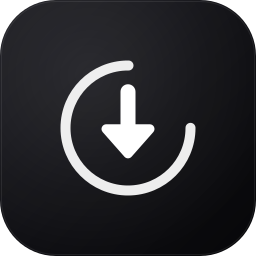
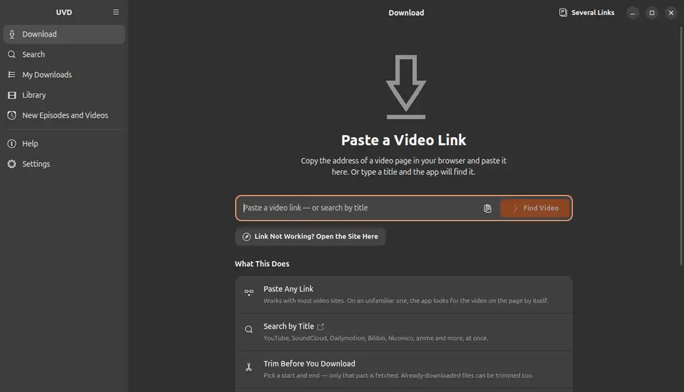
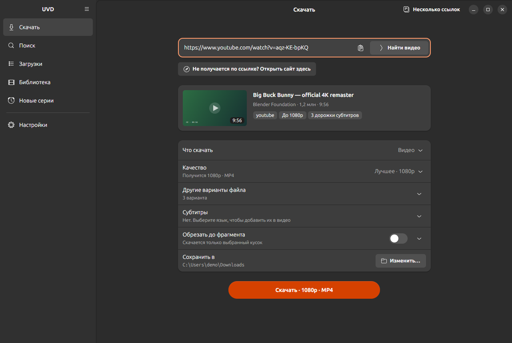
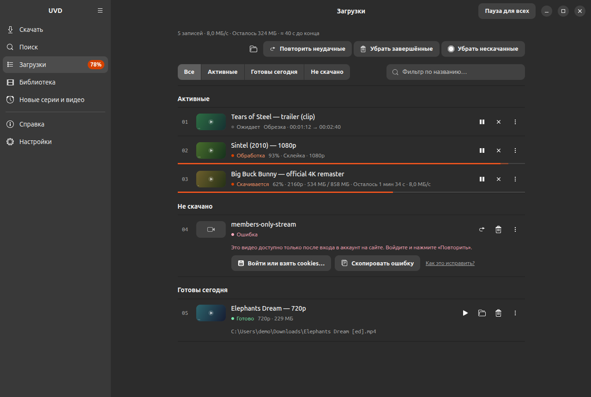
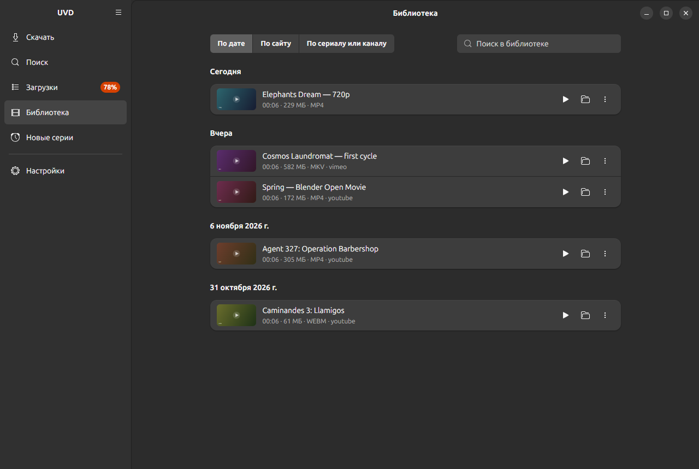
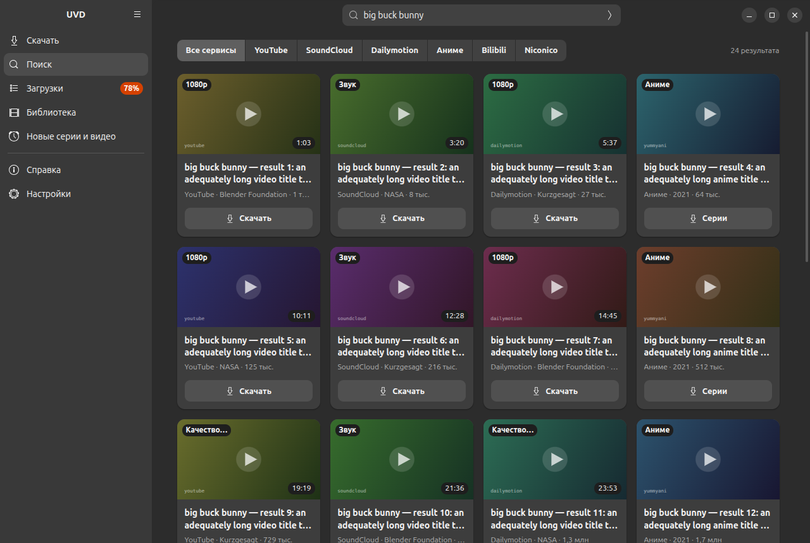
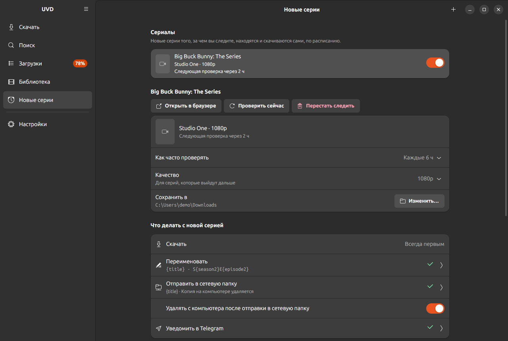
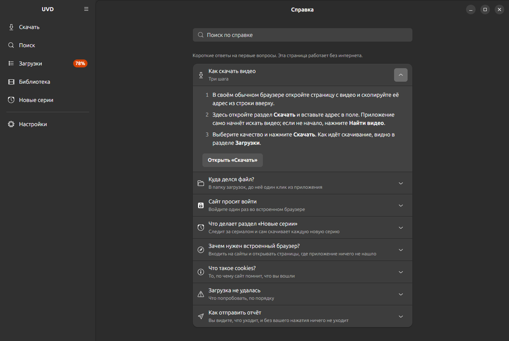
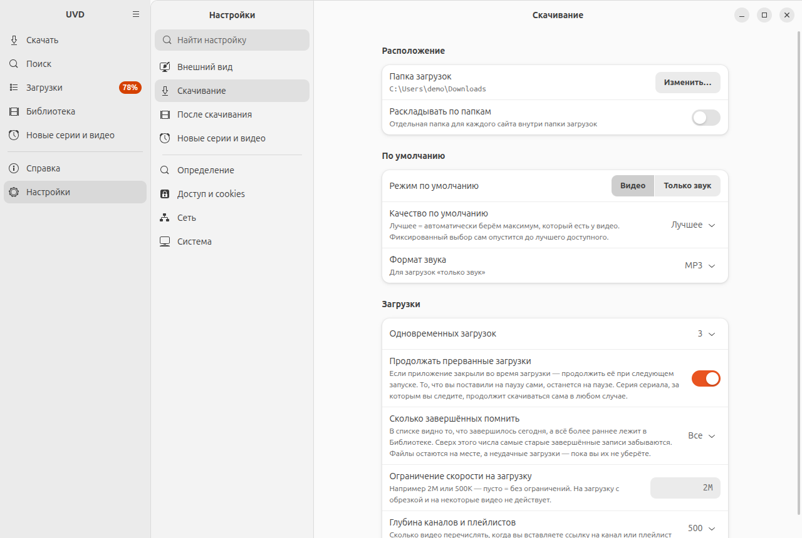
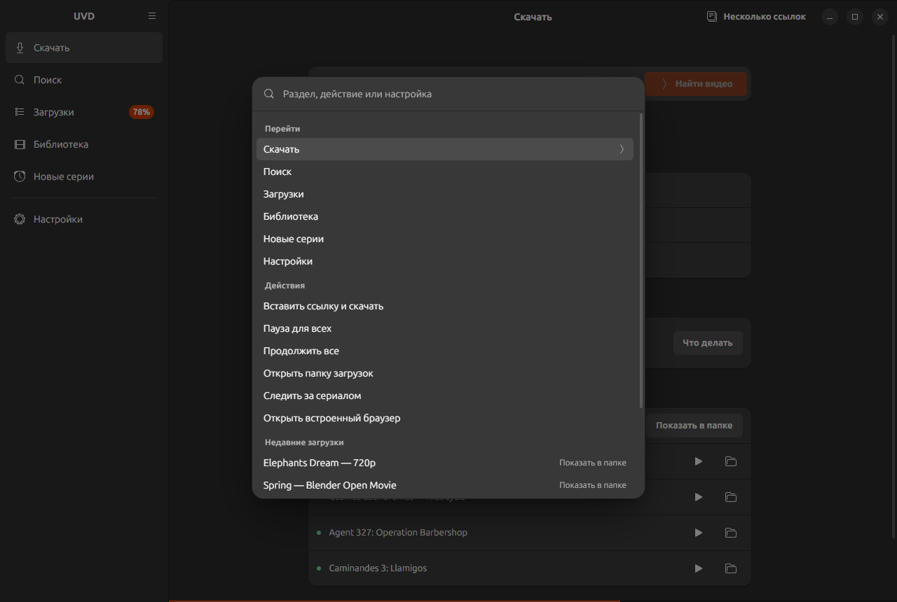

<div align="center">



# Universal Video Downloader

**Вставьте ссылку и получите видео.**<br />
Бесплатное приложение для Windows, macOS и Linux: скачивает видео с YouTube и ещё 1800+ сайтов,<br />
а на страницах, для которых никто не написал поддержку, находит видео само.

[](https://github.com/DenisHumen/Universal-Video-Downloader/releases/latest)
[](https://github.com/DenisHumen/Universal-Video-Downloader/releases/latest)
[](#linux)

[](https://github.com/DenisHumen/Universal-Video-Downloader/releases/latest)
[](https://github.com/DenisHumen/Universal-Video-Downloader/releases)
[](LICENSE)

[English](README.md) · **Русский**

<br />

<a href="docs/assets/tour.mp4?raw=true"></a>
<br /><sub>▶ <a href="docs/assets/tour.mp4?raw=true">тот же обзор в MP4</a></sub>

</div>

<br />

## Чем оно лучше

- **Работает там, где другие сдаются.** Программа yt-dlp знает 1800+ сайтов. Если сайт ей незнаком, приложение читает страницу, а потом открывает её в скрытом браузере и ловит видео в момент загрузки.
- **Говорит, что вы получите, ещё до нажатия.** Кнопки качества берутся из того, что у видео есть на самом деле, а «лучшее» объясняет, что это значит: `2160p60 · HDR · MP4 · ≈ 1.2 GB`.
- **Может вести сериал целиком.** Добавьте сериал в «Новые серии», и каждая новая серия скачается, переименуется, уедет в сетевую папку и придёт уведомлением в Telegram, даже если приложение не открыто.
- **Сайт:** [denishumen.github.io/Universal-Video-Downloader](https://denishumen.github.io/Universal-Video-Downloader/) сам подбирает загрузку для вашего компьютера и показывает все версии.
- **Выглядит как родное приложение.** Версия 4 сделана по образцу GNOME 50 в Ubuntu 26.04: компактная боковая панель и заголовок, списки-карточки, настройки устроены как «Параметры» GNOME, шрифт Ubuntu Sans и оранжевый акцент Yaru, дневная и ночная темы. На Windows и macOS выглядит так же.
- **Без аккаунта, рекламы и телеметрии.** Всё работает на вашем компьютере. Интерфейс на русском и английском.

## Установка

| Платформа | Скачать | |
| --- | --- | --- |
| **Windows 10 / 11** | [`…-windows-x64-setup.exe`](https://github.com/DenisHumen/Universal-Video-Downloader/releases/latest) | обновляется само |
| **macOS 13+**, Apple silicon | [`…-mac-arm64.dmg`](https://github.com/DenisHumen/Universal-Video-Downloader/releases/latest) | см. [первый запуск](#macos-приложение-повреждено-и-не-может-быть-открыто) |
| **macOS 13+**, Intel | [`…-mac-x64.dmg`](https://github.com/DenisHumen/Universal-Video-Downloader/releases/latest) | |
| **Linux** | [apt или dnf](#linux) (лучше всего), либо [`.deb` / `.rpm` / `.AppImage`](https://github.com/DenisHumen/Universal-Video-Downloader/releases/latest) | обновляется вместе с системой |

При первом запуске приложение скачает программу yt-dlp (около 30 МБ) и дальше само будет его обновлять, а затем в фоне — Deno (около 40 МБ, 100 МБ на диске), изолированную программу, которая нужна yt-dlp, чтобы YouTube показывал все качества; ffmpeg уже встроен. Короткая первая настройка спросит, куда сохранять и какие тему и акцент вы хотите; любой шаг можно пропустить. Потом вставьте ссылку, выберите качество и нажмите **Скачать**. Файлы попадают в папку *Загрузки*. Заблудились? *Справка* в главном меню простыми словами отвечает на первые вопросы, и интернет ей не нужен.

### Linux

Ubuntu, Debian, Mint:

```bash
curl -fsSL https://denishumen.github.io/Universal-Video-Downloader/uvd.gpg | sudo tee /usr/share/keyrings/uvd.gpg > /dev/null
echo "deb [arch=amd64 signed-by=/usr/share/keyrings/uvd.gpg] https://github.com/DenisHumen/Universal-Video-Downloader/releases/latest/download/ ./" | sudo tee /etc/apt/sources.list.d/universal-video-downloader.list
sudo apt update && sudo apt install universal-video-downloader
```

Fedora, RHEL, openSUSE (в openSUSE файл кладётся в `/etc/zypp/repos.d/`):

```bash
sudo curl -fsSL -o /etc/yum.repos.d/universal-video-downloader.repo https://denishumen.github.io/Universal-Video-Downloader/universal-video-downloader.repo
sudo dnf install universal-video-downloader
```

Оба репозитория подписаны, обновления приходят вместе с системными (`sudo apt upgrade`, `sudo dnf upgrade`).

В сеансе Wayland приложение работает через XWayland: в родном режиме Wayland окно при перетаскивании отбрасывает в сторону. Если при дробном масштабе экрана (125%, 150%) окно выглядит размытым, запустите приложение с `--ozone-platform=wayland`: размытие уйдёт, но после сворачивания окна в трей перетаскивание снова будет сбоить.

### macOS: «приложение повреждено и не может быть открыто»

**Это не так.** Сборки не подписаны платным сертификатом Apple, и macOS пишет эту фразу про любое неподписанное приложение, которое поместила в карантин. Скопируйте приложение в **Программы** и один раз выполните:

```bash
xattr -dr com.apple.quarantine "/Applications/Universal Video Downloader.app"
```

Эта же команда напечатана в окне установки. Неподписанное приложение не может заменить само себя, поэтому на Mac оно предлагает скачать образ новой версии для вашего процессора вместо обновления на месте.

В образе диска есть **Fix App Is Damaged.command** (дважды щёлкните его после копирования приложения — он выполнит команду за вас) и **How to open on macOS.pdf** с теми же шагами. Если macOS блокирует и скрипт, откройте «Системные настройки» → «Конфиденциальность и безопасность» → «Всё равно открыть» или вставьте команду в «Терминал».

## Скачивание из терминала

```bash
uvd https://www.youtube.com/watch?v=jNQXAC9IVRw
```

`uvd` следует режиму и качеству по умолчанию из настроек приложения (лучшее качество, пока вы их не меняли) и сохраняет в *Загрузки* (или в папку из настроек), с той же программой для скачивания, ffmpeg, cookies, входами на сайты во встроенном браузере и прокси, что и приложение. Флаги ниже переопределяют настройки на этот запуск. `uvd -q 720 <ссылка>` берёт не выше 720p (`best`, `2160`, `1440`, `1080`, `720`, `480` или `360`; если такой высоты у видео нет, берётся лучшее из того, что есть), `uvd -a <ссылка>` сохраняет только звук, `-o <папка>` сохраняет в другое место, несколько ссылок скачиваются по очереди. `uvd --help` покажет всё это. Если ссылку распознать не удалось, `uvd` так и скажет и предложит открыть приложение, у которого больше способов найти поток; код выхода при этом 2, чтобы скрипты могли это отличить. В терминале команда говорит на языке, выбранном в приложении; в канал или файл она пишет по-английски, для скриптов, которые это читают.

- **Linux, apt / dnf / `.deb` / `.rpm`:** `uvd` ставится вместе с приложением.
- **Linux, AppImage:** откройте *Настройки → Система → Журнал и командная строка* и нажмите *Установить* рядом с *Командой для терминала*. В `~/.local/bin` появится небольшой скрипт `uvd`, который запускает AppImage и после обновлений продолжает указывать на него. Если потом перейти на `.deb`, `.rpm` или пакет из AUR, приложение при следующем запуске удалит этот скрипт, чтобы он не заслонял собственную команду `uvd` из пакета. Можно и самому запускать AppImage с `--cli`, например `alias uvd='~/Applications/Universal-Video-Downloader.AppImage --cli'`.
- **macOS:** откройте *Настройки → Система → Журнал и командная строка* и нажмите *Установить* рядом с *Командой для терминала*; macOS один раз спросит пароль, чтобы поставить ссылку в `/usr/local/bin`. Сначала перенесите приложение в «Программы». Или сделайте ссылку сами:

  ```bash
  sudo mkdir -p /usr/local/bin && sudo ln -sf "/Applications/Universal Video Downloader.app/Contents/Resources/bin/uvd" /usr/local/bin/uvd
  ```

## Что оно умеет

| Возможность | Что это даёт |
| --- | --- |
| **Почти любая страница** | Сначала yt-dlp; потом данные плеера на самой странице; потом скрытый браузер, который ловит поток при загрузке. Хватает ссылки из адресной строки. |
| **Честное качество** | Только те качества, что у видео есть на самом деле, и размер файла до скачивания. |
| **Выбор прямо на карточке** | Язык звука, если у видео их несколько, и субтитры на вашем языке, включая автоматические. |
| **Загрузки и библиотека** | В *Загрузках* то, что качается, что не скачалось и что готово сегодня; у неудачной загрузки есть кнопка исправления под её ошибку (войти, другая папка, только звук, повтор). *Библиотека* хранит всё скачанное, по дате, сайту или сериалу, с поиском, воспроизведением и показом в папке. Файл перенесли? *Найти файл…* отыщет его снова. Вставите ссылку на то, что уже есть, и приложение об этом скажет. |
| **Одна полоса прогресса** | Скачивание и всё, что после него (склейка, конвертация, обрезка), в одной полосе с названием текущего шага. Пауза, продолжение, повтор, отмена. |
| **Трансляции и премьеры** | Трансляция записывается, пока вы не нажмёте *Остановить и сохранить*, и всё записанное остаётся у вас. Премьера ещё не началась? *Подождать и скачать* начнёт само, когда она пойдёт. |
| **Обрезка и конвертация** | Скачать только нужный кусок, обрезать готовый файл, перегнать в MP4 / MKV / WebM / MOV / GIF или вытащить MP3 / M4A / FLAC / OPUS. |
| **Поиск по названию** | YouTube, SoundCloud, Dailymotion, Bilibili, Niconico и каталог YummyAnime, в одном сервисе или во всех сразу. PornHub — после включения в настройках. |
| **Встроенный браузер** | Для упрямых страниц: откройте её, нажмите play, и каждый поток появится в боковой панели, в один клик до очереди. Войдите на сайт в нём один раз, и вход сохранится: после перезапуска, для загрузок с этого сайта, а пароль запомнится и подставится сам. |
| **Сериалы и плейлисты** | Озвучки, сезоны и серии на HDrezka, YummyAnime и AniLiberty; плейлисты и каналы списком с выбором; целый список ссылок за раз. |
| **Новые серии** | Следите за сериалом, и каждая новая серия скачивается по расписанию, в ту папку и с тем качеством, что вы выбрали для этого сериала; можно ещё переименовать, отправить в сетевую папку (SMB) и получить сообщение в Telegram. |
| **Автоматическая загрузка** | По желанию: скопируйте ссылку на видео, и она начнёт скачиваться сама, с отдельным ползунком для каждого сайта (*Настройки → Определение*). |
| **Видео со входом** | Видео с проверкой возраста и только для подписчиков: войдите один раз во встроенном браузере (включая Google), перенесите входы из Firefox, Chrome или другого браузера одной кнопкой или используйте cookies своего браузера или `cookies.txt`. |
| **Справка** | Простые ответы и кнопка, которая ведёт куда нужно: как скачать, куда делся файл, как войти на сайт, что делать при ошибке. В главном меню и по <kbd>Ctrl</kbd>+<kbd>K</kbd>; у неудачной загрузки есть ссылка на нужный ответ. |
| **С клавиатуры** | <kbd>Ctrl</kbd>+<kbd>K</kbd> открывает палитру команд: любой раздел, действие, настройка или недавняя загрузка; <kbd>Ctrl</kbd>+<kbd>1</kbd>…<kbd>5</kbd> переключают разделы, <kbd>Ctrl</kbd>+<kbd>,</kbd> открывает настройки. |
| **Остальное** | Встроенные субтитры, обложки и главы, SponsorBlock, папки по сайтам, шаблон имени, ограничение скорости, прокси, *Отправить в сетевую папку…* для любого готового файла, дневная и ночная темы с десятью цветами акцента, уведомления, открывающие нужную строку, и файл резервной копии, который переносит настройки и сериалы на новый компьютер. |

## Скриншоты

<table>
  <tr>
    <td width="50%"><p align="center"><b>Скачать</b> · вставьте ссылку и посмотрите, что получите</p></td>
    <td width="50%"><p align="center"><b>Загрузки</b> · одна полоса на всю работу, исправление для каждой ошибки</p></td>
  </tr>
  <tr>
    <td><p align="center"><b>Библиотека</b> · всё скачанное, по дате, сайту или сериалу</p></td>
    <td><p align="center"><b>Поиск</b> · по названию, сразу по сервисам</p></td>
  </tr>
  <tr>
    <td><p align="center"><b>Новые серии</b> · каждая новая серия без вашего участия</p></td>
    <td><p align="center"><b>Справка</b> · простые ответы и кнопка, которая ведёт куда нужно</p></td>
  </tr>
  <tr>
    <td><p align="center"><b>Настройки</b> · как «Параметры» GNOME</p></td>
    <td><p align="center"><b>Ctrl+K</b> · куда угодно и что угодно</p></td>
  </tr>
</table>

## Сайт не работает?

1. **Откройте встроенный браузер.** Откройте страницу в нём и нажмите play; всё, что она воспроизводит, появится в боковой панели. Закрытый баннер согласия или выполненный вход запоминаются, и загрузки идут с этим входом, если другие cookies не выбраны.
2. **Включите cookies.** *Настройки → Доступ и cookies*, выберите браузер, в котором вы вошли в аккаунт. Проверка возраста, вход и «только для подписчиков» перестанут мешать. Закройте этот браузер на время скачивания: он блокирует свою базу cookies.
3. **Отправьте отчёт.** Когда ссылка не сработала, приложение предложит отправить разработчику ссылку, ошибку и технические подробности. Без вашего клика ничего не уходит, а пути, пароли и токены вырезаются заранее.
4. **Или [заведите issue](https://github.com/DenisHumen/Universal-Video-Downloader/issues/new)** со ссылкой и *техническими подробностями* из её строки в разделе *Загрузки*.

## Подробнее

<details>
<summary><b>Как работает определение</b></summary>

<br />

Приложение пробует три способа, от самого дешёвого, и останавливается на первом сработавшем:

1. **Движок.** yt-dlp знает 1800+ сайтов: YouTube (и Shorts), TikTok, Instagram, X/Twitter, Reddit, Twitch, VK, Vimeo, SoundCloud, Bilibili и другие. Ссылки «поделиться» сначала очищаются, поэтому `youtu.be/…?si=…` и `/shorts/…` попадают в очередь одним и тем же видео.
2. **Сама страница.** JSON-LD `VideoObject`, OpenGraph `og:video`, теги `<video>`, настройки JW Player / Video.js / Plyr и один уровень iframe с плеером.
3. **Скрытый браузер.** Страница открывается в невидимом окне Chromium, плеер запускается, а манифест перехватывается из сети вместе с заголовками `Referer`, `Origin` и `Cookie`, которые нужны серверу; движок потом использует их же.

Кандидаты ранжируются (HLS ≫ DASH ≫ MP4 ≫ аудио; трейлеры, реклама и отдельные сегменты понижаются) по типу ответа, а не только по имени файла, поэтому работают и манифесты без расширения. Ссылки на потоки протухают, поэтому очередь хранит адрес *страницы* и определяет поток заново при каждом старте и повторе. Скрытый браузер отключается в *Настройки → Определение*.

</details>

<details>
<summary><b>Новые серии</b></summary>

<br />

Вставьте ссылку на страницу сериала, выберите озвучку (у разных озвучек разное число серий, от неё зависит, что считать новым) и как часто проверять. У каждого сериала своё качество и своя папка, их можно поменять и потом. Каждая новая серия проходит выбранные вами шаги:

| Шаг | Что делает |
| --- | --- |
| **скачать** | Всегда первый, через обычную очередь: пауза, повтор и история работают как всегда. |
| **переименовать** | Шаблон с `{title}` `{season}` `{episode}` `{season2}` `{episode2}` `{quality}` `{year}` и правила замены в названии. |
| **отправить в сетевую папку** | Загрузка в сетевую папку (SMB) с созданием недостающих папок; может удалить локальную копию. Папка выбирается через *Обзор…* (папка, подключённая в системе) или *Обзор общей папки…* (прямо в приложении), путь вводить не нужно. |
| **уведомить в Telegram** | Сообщение от вашего бота, когда серия пришла или не скачалась. |

Проверки идут по расписанию с паузами после ошибок (не чаще раза в 15 минут); **проверить сейчас** запускает проверку сразу. *Настройки → Новые серии* оставляют расписание работать из трея при закрытом окне и могут запускать приложение вместе с системой. Пароль SMB и токен Telegram шифруются хранилищем ключей системы. Заметки о дизайне: [`docs/automation.md`](docs/automation.md).

</details>

<details>
<summary><b>Настройки</b></summary>

<br />

Настройки устроены как «Параметры» GNOME: восемь разделов списком слева, подстраницы, которые выезжают справа, и поиск по любой строке. Открываются по <kbd>Ctrl</kbd>+<kbd>,</kbd>.

| Раздел | Что там |
| --- | --- |
| **Внешний вид** | Стиль (день, ночь или как в системе), цвет акцента (десять цветов GNOME 50 в оттенках Ubuntu 26.04, включая коричневый, или системный), язык |
| **Скачивание** | Папка, подпапки по сайтам, режим и качество по умолчанию, формат звука, параллельные загрузки, продолжение после перезапуска, сколько готовых держать в списке, ограничение скорости, глубина плейлиста |
| **После скачивания** | Встраивать обложку / метаданные / главы / субтитры, файлы `.srt`, языки субтитров, SponsorBlock, предпочитать H.264 + AAC, шаблон имени файла |
| **Новые серии** | Проверка в фоне; *Сетевые папки* (SMB) и *Telegram* отдельными страницами |
| **Определение** | Автоматическая загрузка с ползунком для каждого сайта, скрытый браузер для незнакомых сайтов, сервисы поиска |
| **Доступ и cookies** | *Встроенный браузер* (оставаться в системе, сохранённые пароли, выход со всех сайтов); cookies из Chrome, Firefox, Edge, Safari, Brave, Chromium, Opera, Vivaldi или *Файл cookies*; отчёты об ошибках |
| **Сеть** | *Прокси* для движка и для собственных запросов приложения |
| **Система** | *Запуск и уведомления* (запуск с системой, иконка в трее, слежение за буфером обмена, уведомления), *Обновления* (проверка раз в шесть часов: на Windows и в AppImage новая версия ставится сама, на macOS и для `.deb` / `.rpm` открывается её загрузка), *Резервная копия*, *Журнал и командная строка*, *О приложении* |

Настройки, история и сериалы хранятся в папке данных приложения пользователя; журнал (`uvd.log`) лежит рядом, секреты и подписанные ссылки в нём скрываются до записи.

</details>

<details>
<summary><b>Разработчикам</b></summary>

<br />

Electron 45, React 18, TypeScript, Tailwind и Zustand вокруг yt-dlp и ffmpeg. Команды, релизы, дизайн-система и устройство проекта описаны в [`docs/DEVELOPMENT.md`](docs/DEVELOPMENT.md) (на английском). Пулл-реквесты приветствуются; запросы на новые сайты тоже, здесь или в [Telegram](https://t.me/DenisHumen).

</details>

## Правовое

Для скачивания контента, к которому у вас есть право доступа. Соблюдайте условия и авторские права сайтов, с которыми работаете.

[MIT](LICENSE) © Denis Humen
